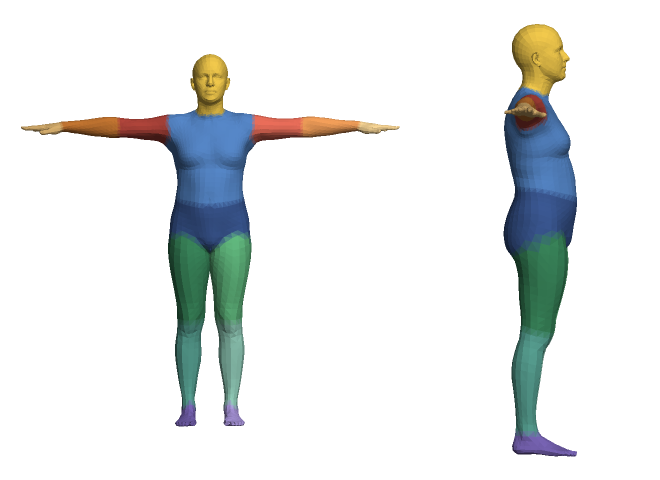
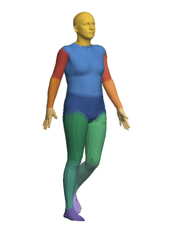
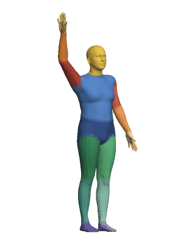

# photo2avatar

Turns a photo of a person into an animated 3D avatar. HMR2.0 reconstructs the body, the mesh is
split into body parts and rigged with a 24-joint skeleton, and the result is saved as a single
`.glb` file with three animations. You can open it in Blender, three.js or any glTF viewer.

| Body parts | Walk | Wave |
|:---:|:---:|:---:|
|  |  |  |

## How it works

1. **Body reconstruction.** HMR2.0 predicts SMPL shape, pose and camera from the photo. The model
   works best on a tight crop around the person. The first pass runs on the whole image, and the
   projected mesh from that pass is used as the crop for the second one. This replaces a separate
   person detector.
2. **Rig.** The predicted shape is applied to the SMPL template in T-pose. SMPL already comes with
   a skeleton and skinning weights (at most 4 per vertex), so they are exported directly.
3. **Segmentation.** Every vertex is assigned to the joint with the largest skinning weight. Joints
   are grouped into 15 parts: head, torso, hips, and an upper arm, forearm, hand, thigh, shin and
   foot on each side.
4. **Animation.** There are three clips. `photo_pose` goes from the T-pose to the pose in the photo.
   `walk` and `wave` are procedural, built from sine curves on joint angles.
5. **Export.** The GLB is written with numpy only. It contains the mesh, part colours, skin, inverse
   bind matrices and quaternion animation tracks.

Output files:
- `avatar.glb`
- `overlay.jpg`: the mesh drawn over the photo
- `avatar.png`: the estimated pose, front and side
- `parts.png`
- `walk.gif` and `wave.gif`
- `report.json`

## Results

Apple M2, 8 GB, PyTorch on MPS:

- Inference takes about 8 s for two HMR2.0 passes. Loading the 2.7 GB checkpoint takes another 30–90 s.
- The exported rig matches SMPL's own skinning to under 0.001 mm.
- Without SMPL's pose-corrective blend shapes, vertices move 4–7 mm on average.
- `avatar.glb` is 0.64 MB, with 6,890 vertices and 13,776 faces.

## Setup

Requires Python 3.10, because the SMPL loader (chumpy) doesn't work with newer numpy.

```bash
python3.10 -m venv .venv
source .venv/bin/activate
pip install -r requirements.txt

# HMR2.0 weights, about 2.7 GB, saved to ~/.cache/4DHumans
python -c "from hmr2.models import download_models; download_models()"
```

The SMPL model needs a free registration at https://smpl.is.tue.mpg.de. Download it and put
`SMPL_NEUTRAL.pkl` into `~/.cache/4DHumans/data/smpl/`.

## Usage

```bash
python -m photo2avatar photo.jpg -o out/
```

The photo should show one person, fully in frame. Options:
- `--device cuda|mps|cpu`
- `--passes 1` uses the whole image only
- `--box X1 Y1 X2 Y2` sets the person box for the first pass

`--mean-body` skips the photo and exports the average SMPL body. This is useful for checking the
rig and export without HMR2.0.

To see the animations, drag `out/avatar.glb` into https://gltf-viewer.donmccurdy.com.

## Tests

```bash
python -m tests.test_rig    # or: pytest tests
```

The tests check that:
- the rig reproduces SMPL skinning for random poses;
- segmentation covers every vertex and is left/right symmetric;
- the walk and wave clips loop without a jump;
- the GLB reads back with the same vertices, weights, bind matrices and animation tracks.

## Limitations

- SMPL is a body without clothes or hair, and there is no texture.
- Absolute size can't be recovered from a single photo. The height comes from the SMPL shape.
- glTF skinning has no pose-corrective blend shapes, so elbows and knees bend a bit less cleanly than in SMPL.
- The walk and wave are hand-made curves, not a learned motion model.
- Only one person per photo.

## Project structure

```
photo2avatar/
  hmr.py          HMR2.0 loading and the two-pass crop
  body.py         SMPL rig, skinning, part segmentation
  animation.py    photo_pose, walk and wave clips
  gltf_export.py  GLB writer and reader
  render.py       software renderer for previews and GIFs
  rotations.py    rotation and quaternion helpers
  pipeline.py     end-to-end run
tests/
  test_rig.py
```

## License note

SMPL and the HMR2.0 weights are licensed separately for non-commercial research use and are not
included here. Generated `.glb` files contain SMPL-derived data, so they are git-ignored as well.
